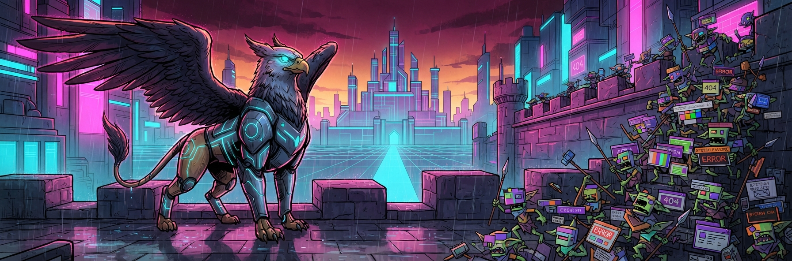

# James the Gryphon

James the Gryphon checks whether your UI code still follows your DESIGN.md. It reads the design tokens in your project's [DESIGN.md](https://github.com/google-labs-code/design.md) and scans your CSS, SCSS, Vue and Tailwind code for colours, fonts, font sizes, spacing and corner radii that are not in those tokens. For each one it tells you the file, the line, the nearest token and how to fix it. It will run as a CLI, as a GitHub Action that checks the files a pull request touches, and as a browser playground where nothing you paste ever leaves your machine. The project is in development: see [docs/SPEC.md](docs/SPEC.md) and [docs/STATUS.md](docs/STATUS.md).

Built by Claude Code. Directed and reviewed by Shawn.

## Run it locally

The package is not on npm yet. Until it is, run it from a clone of this repo, in the repo's root folder. You need Node 22.13 or newer.

```bash
npm ci
```

```bash
npm run build
```

```bash
npm run gryphon -- check
```

The `--` passes the rest to the CLI. `npm run gryphon -- --help` lists the options.

`npm run gryphon` checks from the repo root, so paths are relative to it. To check another project, pass its folder and its DESIGN.md:

```bash
npm run gryphon -- check ../my-app/src --design ../my-app/DESIGN.md
```

Or run the built file from inside the other project, so paths in the report are relative to it:

```bash
node /path/to/gryphon/packages/gryphon-designmd/dist/src/cli/main.js check
```

It checks `.css`, `.scss` and `.vue` files: Vue `<style>` blocks (CSS and SCSS) and static `style` attributes. Tailwind classes follow later in Gate 4.

**Do not use `npx gryphon`.** Before our package is published, `npx` cannot find a local command with that name, so it downloads an unrelated npm package called `gryphon` instead. After release, the command will be `npx gryphon-designmd`.

## Ignore comments

To accept a value on purpose, put an ignore comment above it. A reason after a colon is optional but helps reviewers:

```css
.partner-logo {
  /* gryphon-ignore-next-line: partner brand colour, not ours */
  color: #e4002b;
}
```

| Comment | Effect |
| --- | --- |
| `gryphon-ignore-next-line` | Ignores findings on the next line. |
| `gryphon-ignore-file` | Placed before any rule, ignores the whole file. In a `.vue` file, an HTML comment before the first block ignores the file; inside a `<style>` block it ignores that block only. |

They work in CSS comments (`/* */`), SCSS comments (`//`) and, in Vue templates, HTML comments (`<!-- -->`). The spelling must be exact, so a typo is not silently accepted. Every ignored finding is counted: the report says, for example, "1 suppressed by ignore comments.", and the JSON report has `summary.suppressed`.

## Configuration

Everything works without a config file. To change the defaults, add `gryphon.config.json` to your project root, or pass `--config <path>`. It is plain JSON: it is read, never run. Every field is optional:

```json
{
  "design": "docs/DESIGN.md",
  "include": ["src/**"],
  "exclude": ["**/legacy/**"],
  "tokenSources": ["src/styles/tokens.css"],
  "rootPx": 16,
  "rules": { "raw-token-value": "off", "off-token": "error" }
}
```

| Field | Meaning |
| --- | --- |
| `design` | Path to DESIGN.md. `--design` wins over it. |
| `include` | Only check files matching one of these globs. |
| `exclude` | Do not check files matching one of these globs. |
| `tokenSources` | Files where your tokens are defined. See "Token files and local redefinitions" below. |
| `rootPx` | Pixels per `rem` and `em`. Default 16. |
| `rules` | `"error"`, `"warning"` or `"off"` for `off-token` and `raw-token-value`. |

Globs support `**` (any folders), `*` (anything in one folder) and `?` (one character), with `/` between folders.

### Token files and local redefinitions

A colour defined in a custom property outside your token files is a local redefinition, for example `--hero-orange: #f34213` in a component. gryphon checks it like any hard-coded colour: a copy of a token's value is a warning, and any other colour is an error.

Which files count as token files:

- **Without `tokenSources`:** any CSS or SCSS file with a `:root` rule that defines custom properties. In a `.vue` file, each `<style>` block is judged on its own: a `<style>` block with a `:root` rule counts as a token source, but the component's other style blocks are still checked.
- **With `tokenSources`:** exactly the files that match its globs, and nothing else. A `:root` block anywhere else is then checked too.

Only colours in custom properties are checked. A size such as `--card-gap: 13px` could be spacing, a radius or a font size, so it is left alone. SCSS `$variables` are not checked.
